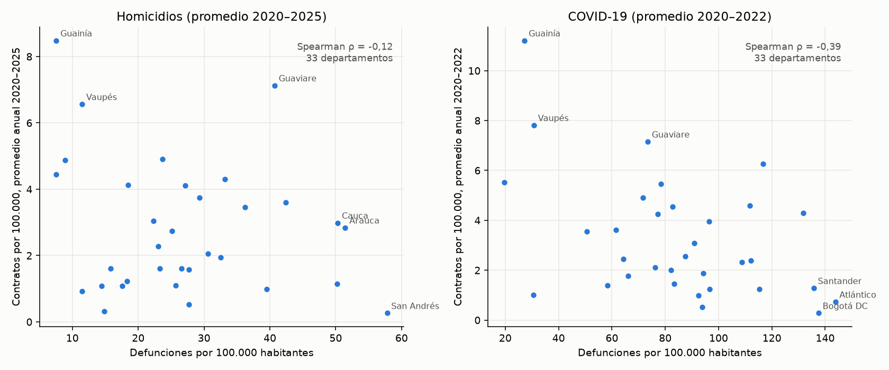

# Causas de defunción y contratación funeraria pública por departamento (D107)

> **Análisis exploratorio y ecológico (D107 aprobada por Edward el 2026-11-08; D107b, pendiente de revisión).** No se interpreta ninguna asociación como causal; la unidad es el departamento (la entidad contratante y el residente fallecido pueden estar en departamentos distintos). Rama `causas-defuncion`, sin integrar a `main`.

## 1. Datos y verificación

Seis cuadros unificados de defunciones no fetales del DANE (cifras definitivas 2020 a 2025; la de 2025 se publicó el 24 de septiembre de 2026), Cuadro 5 (departamento de residencia × lista 6/67 de la OPS) y, para la COVID-19, Cuadro 16 (`U07`). Archivos en `data/raw/dane/eevv/` con URL, fecha, tamaño y SHA-256 en el manifiesto. El equivalente de cada grupo en la lista 6/67 y el tratamiento de la COVID-19 están en la enmienda de D107.

**Verificación de totales nacionales** (suma de los 33 departamentos más «Extranjero» y «Sin información» frente al Índice del DANE y a la fila `TOTAL` del Cuadro 5):

| Año | Total publicado (Índice) | Total nacional (Cuadro 5) | Suma de departamentos y no asignados | Suma de los siete grupos | Diferencia |
|---|---|---|---|---|---|
| 2020 | 300.853 | 300.853 | 300.853 | 300.853 | 0 |
| 2021 | 363.089 | 363.089 | 363.089 | 363.089 | 0 |
| 2022 | 287.251 | 287.251 | 287.251 | 287.251 | 0 |
| 2023 | 268.411 | 268.411 | 268.411 | 268.411 | 0 |
| 2024 | 275.778 | 275.778 | 275.778 | 275.778 | 0 |
| 2025 | 284.254 | 284.254 | 284.254 | 284.254 | 0 |

La diferencia es 0 en los seis años. **COVID-19** (EEVV: `U07` del Cuadro 16; INS: fallecidos por fecha de muerte en `data/raw/covid/`):

| Año | EEVV (U07, suma de departamentos) | INS (fallecidos) | INS − EEVV | Diferencia relativa |
|---|---|---|---|---|
| 2020 | 51.197 | 50.099 | -1.098 | -2,1 % |
| 2021 | 90.668 | 102.436 | 11.768 | 13,0 % |
| 2022 | 13.385 | 25.369 | 11.984 | 89,5 % |

El INS cuenta fallecidos con COVID-19 confirmado por fecha de muerte y las EEVV cuentan la causa certificada por residencia, de modo que no tienen por qué coincidir: el INS supera a las EEVV en 2021 y en 2022 (en 2020 la diferencia es de -2,1 %). Esta diferencia se reporta y no se corrige. De 2023 en adelante la COVID-19 no se observa en las EEVV por departamento (queda dentro de «demás causas»), mientras el INS registra 6.455 fallecidos en 2023.

**Cobertura de la COVID-19 por departamento.** `U07` aparece entre las diez primeras causas en 2020: 33 de 33 departamentos, 2021: 33 de 33 departamentos, 2022: 32 de 33 departamentos; los demás quedan en «demás causas» y la COVID-19 de esos departamentos-año es **faltante** (no 0): el modelo de COVID-19 los excluye (n = 98). En 2023 a 2025 no es observable (faltante).

**Tasas por 100.000 habitantes** (mediana de los 33 departamentos, mínimo y máximo de los promedios anuales 2020–2025; COVID-19: 2020–2022):

| Causa | Mediana | Mínimo | Máximo |
|---|---|---|---|
| Agresiones (homicidios) | 25,7 | 7,6 | 57,8 |
| Accidentes de transporte | 15,9 | 1,9 | 34,3 |
| Otras causas externas (no homicidio ni transporte) | 22,7 | 11,8 | 63,7 |
| COVID-19 | 83,4 | 19,7 | 143,8 |
| Sistema circulatorio | 155,7 | 43,7 | 253,3 |
| Neoplasias | 78,6 | 20,2 | 152,0 |
| Demás causas | 167,6 | 87,4 | 309,5 |

## 2. Transversal por departamento (Spearman, 33 departamentos)

Tasa promedio de cada causa 2020–2025 (COVID-19: 2020–2022) frente a contratos funerarios y valor, por 100.000 habitantes (promedio anual 2020–2025). Holm por causa (7) dentro de cada resultado. IC 95 % por transformación de Fisher (aproximado). La última columna es la sensibilidad con el promedio 2020–2024 (p de Holm).

**Contratos por 100.000**

| Causa | n | ρ | IC 95 % | p | p de Holm | p de Holm < 0,05 | Sin 2025: p de Holm |
|---|---|---|---|---|---|---|---|
| Agresiones (homicidios) | 33 | -0,12 | -0,46 a 0,26 | 0,513 | 1,000 | no | 0,995 (ρ = -0,12) |
| Accidentes de transporte | 33 | 0,12 | -0,26 a 0,46 | 0,514 | 1,000 | no | 0,995 (ρ = 0,12) |
| Otras causas externas (no homicidio ni transporte) | 33 | 0,51 | 0,18 a 0,73 | 0,003 | 0,018 | sí | 0,021 (ρ = 0,50) |
| COVID-19 | 33 | -0,38 | -0,65 a -0,02 | 0,029 | 0,143 | no | 0,136 (ρ = -0,38) |
| Sistema circulatorio | 33 | -0,34 | -0,63 a 0,02 | 0,052 | 0,174 | no | 0,194 (ρ = -0,33) |
| Neoplasias | 33 | -0,42 | -0,68 a -0,06 | 0,016 | 0,097 | no | 0,110 (ρ = -0,41) |
| Demás causas | 33 | -0,35 | -0,63 a 0,01 | 0,044 | 0,174 | no | 0,156 (ρ = -0,36) |

**Valor por 100.000**

| Causa | n | ρ | IC 95 % | p | p de Holm | p de Holm < 0,05 | Sin 2025: p de Holm |
|---|---|---|---|---|---|---|---|
| Agresiones (homicidios) | 33 | -0,20 | -0,53 a 0,17 | 0,260 | 0,780 | no | 0,566 (ρ = -0,23) |
| Accidentes de transporte | 33 | -0,06 | -0,41 a 0,31 | 0,759 | 0,780 | no | 0,826 (ρ = -0,10) |
| Otras causas externas (no homicidio ni transporte) | 33 | 0,19 | -0,18 a 0,52 | 0,285 | 0,780 | no | 0,826 (ρ = 0,15) |
| COVID-19 | 33 | -0,36 | -0,64 a 0,00 | 0,040 | 0,162 | no | 0,138 (ρ = -0,37) |
| Sistema circulatorio | 33 | -0,56 | -0,77 a -0,25 | < 0,001 | 0,005 | sí | 0,006 (ρ = -0,55) |
| Neoplasias | 33 | -0,53 | -0,75 a -0,21 | 0,001 | 0,009 | sí | 0,010 (ρ = -0,53) |
| Demás causas | 33 | -0,52 | -0,74 a -0,20 | 0,002 | 0,010 | sí | 0,018 (ρ = -0,49) |

## 2b. Transversal con tasas estandarizadas por edad (D107b)

Misma prueba de la sección 2 (Spearman, promedio 2020–2025, Holm entre 7 causas) con tasas estandarizadas por el método directo, población estándar Colombia 2020 (pesos por grupo de edad: 100 mas 0,0 %, 15 44 46,2 %, 1 4 6,1 %, 45 64 20,1 %, 5 14 16,6 %, 65 84 8,4 %, 85 99 1,0 %, menor 1 1,5 %). Las defunciones de edad desconocida se reparten en proporción. **La COVID-19 no se puede estandarizar** (el Cuadro 16 no trae edad): se usa su tasa cruda de 2020–2022, y «demás causas» incluye la COVID-19 de 2020–2022.

**Contratos por 100.000**

| Causa | n | ρ | IC 95 % | p | p de Holm | p de Holm < 0,05 | Sin 2025: p de Holm |
|---|---|---|---|---|---|---|---|
| Agresiones (homicidios) | 33 | -0,11 | -0,45 a 0,27 | 0,556 | 1,000 | no | 1,000 (ρ = -0,09) |
| Accidentes de transporte | 33 | 0,14 | -0,23 a 0,48 | 0,423 | 1,000 | no | 1,000 (ρ = 0,16) |
| Otras causas externas (no homicidio ni transporte) | 33 | 0,67 | 0,40 a 0,83 | < 0,001 | < 0,001 | sí | < 0,001 (ρ = 0,65) |
| COVID-19 | 33 | -0,38 | -0,65 a -0,02 | 0,029 | 0,171 | no | 0,163 (ρ = -0,38) |
| Sistema circulatorio | 33 | -0,15 | -0,49 a 0,22 | 0,403 | 1,000 | no | 1,000 (ρ = -0,13) |
| Neoplasias | 33 | -0,28 | -0,58 a 0,09 | 0,118 | 0,588 | no | 0,509 (ρ = -0,29) |
| Demás causas | 33 | -0,05 | -0,40 a 0,32 | 0,787 | 1,000 | no | 1,000 (ρ = -0,05) |

**Valor por 100.000**

| Causa | n | ρ | IC 95 % | p | p de Holm | p de Holm < 0,05 | Sin 2025: p de Holm |
|---|---|---|---|---|---|---|---|
| Agresiones (homicidios) | 33 | -0,19 | -0,52 a 0,18 | 0,278 | 0,834 | no | 0,763 (ρ = -0,20) |
| Accidentes de transporte | 33 | -0,01 | -0,37 a 0,35 | 0,943 | 1,000 | no | 1,000 (ρ = -0,05) |
| Otras causas externas (no homicidio ni transporte) | 33 | 0,40 | 0,04 a 0,66 | 0,022 | 0,153 | no | 0,293 (ρ = 0,35) |
| COVID-19 | 33 | -0,36 | -0,64 a 0,00 | 0,040 | 0,243 | no | 0,241 (ρ = -0,37) |
| Sistema circulatorio | 33 | -0,24 | -0,56 a 0,13 | 0,172 | 0,687 | no | 0,536 (ρ = -0,27) |
| Neoplasias | 33 | -0,32 | -0,61 a 0,05 | 0,073 | 0,365 | no | 0,293 (ρ = -0,35) |
| Demás causas | 33 | 0,01 | -0,35 a 0,37 | 0,947 | 1,000 | no | 1,000 (ρ = 0,01) |

## 3. Panel departamento × año (binomial negativa)

Contratos funerarios por departamento-año (n = 198: 33 departamentos × 6 años), offset log(población), efectos fijos de año, errores agrupados por departamento. Razón de tasas (IRR) **por cada duplicación de (1 + tasa)**: `exp(β·ln 2)`.

### 3.1 Modelo conjunto sin COVID-19 (B1a, 2020–2025)

Variables eliminadas por VIF ≥ 5 (en orden): Neoplasias (VIF 5,4). VIF finales: Agresiones (homicidios) 1,31, Accidentes de transporte 2,07, Otras causas externas (no homicidio ni transporte) 1,12, Sistema circulatorio 3,51, Demás causas 2,50. α estimado = 0,236.

| Causa | IRR por duplicación | IC 95 % | p | p de Holm (entre las del modelo) |
|---|---|---|---|---|
| Agresiones (homicidios) | 0,88 | 0,70 a 1,10 | 0,273 | 0,545 |
| Accidentes de transporte | 1,47 | 1,04 a 2,08 | 0,030 | 0,120 |
| Otras causas externas (no homicidio ni transporte) | 2,35 | 1,66 a 3,32 | < 0,001 | < 0,001 |
| Sistema circulatorio | 0,62 | 0,38 a 1,01 | 0,056 | 0,167 |
| Demás causas | 0,79 | 0,37 a 1,71 | 0,547 | 0,547 |

### 3.1b Modelo conjunto con COVID-19 (B1b, solo 2020–2022, n = 98)

Variables eliminadas por VIF ≥ 5: Sistema circulatorio (VIF 6,4). α estimado = 0,196. Con tres años y la tasa de COVID-19 correlacionada con las demás, el modelo es inestable; se muestra sin interpretación.

| Causa | IRR por duplicación | IC 95 % | p | p de Holm (entre las del modelo) |
|---|---|---|---|---|
| Agresiones (homicidios) | 0,88 | 0,67 a 1,17 | 0,379 | 0,638 |
| Accidentes de transporte | 1,68 | 1,16 a 2,42 | 0,006 | 0,028 |
| Otras causas externas (no homicidio ni transporte) | 2,37 | 1,66 a 3,39 | < 0,001 | < 0,001 |
| COVID-19 | 0,81 | 0,59 a 1,11 | 0,189 | 0,566 |
| Neoplasias | 0,46 | 0,26 a 0,83 | 0,010 | 0,039 |
| Demás causas | 1,69 | 0,60 a 4,71 | 0,319 | 0,638 |

### 3.2 Un modelo por causa (B2)

Una causa a la vez con efectos fijos de año; COVID-19 solo con 2020–2022 y departamentos-año observados (n = 98). Holm entre las siete causas.

| Causa | IRR por duplicación | IC 95 % | p | p de Holm | n |
|---|---|---|---|---|---|
| Agresiones (homicidios) | 0,89 | 0,68 a 1,17 | 0,398 | 0,795 | 198 |
| Accidentes de transporte | 1,00 | 0,66 a 1,49 | 0,982 | 0,982 | 198 |
| Otras causas externas (no homicidio ni transporte) | 2,06 | 1,30 a 3,25 | 0,002 | 0,014 | 198 |
| COVID-19 | 0,74 | 0,54 a 1,02 | 0,067 | 0,267 | 98 |
| Sistema circulatorio | 0,71 | 0,54 a 0,94 | 0,018 | 0,110 | 198 |
| Neoplasias | 0,70 | 0,49 a 0,99 | 0,043 | 0,213 | 198 |
| Demás causas | 0,66 | 0,36 a 1,23 | 0,192 | 0,575 | 198 |

**Sensibilidad** (IRR; p nominal), con la regla de D107: sin Bogotá D.C., sin San Andrés, sin 2020 y sin 2025 (en COVID-19, sin 2025 no aplica):

| Causa | Sin Bogotá | Sin San Andrés | Sin 2020 | Sin 2025 |
|---|---|---|---|---|
| Agresiones (homicidios) | 0,87 (p 0,273) | 0,91 (p 0,517) | 0,90 (p 0,477) | 0,88 (p 0,360) |
| Accidentes de transporte | 0,98 (p 0,908) | 1,01 (p 0,970) | 1,00 (p 0,994) | 1,00 (p 0,998) |
| Otras causas externas (no homicidio ni transporte) | 1,95 (p 0,003) | 2,02 (p 0,003) | 1,99 (p 0,004) | 2,03 (p 0,001) |
| COVID-19 | 0,79 (p 0,127) | 0,74 (p 0,068) | 0,69 (p 0,014) | n. a. |
| Sistema circulatorio | 0,72 (p 0,023) | 0,72 (p 0,021) | 0,72 (p 0,028) | 0,73 (p 0,039) |
| Neoplasias | 0,73 (p 0,070) | 0,69 (p 0,041) | 0,70 (p 0,042) | 0,70 (p 0,052) |
| Demás causas | 0,65 (p 0,168) | 0,66 (p 0,183) | 0,66 (p 0,190) | 0,67 (p 0,246) |

### 3.3 Supuestos (estadístico, gl, p y decisión)

Sobredispersión: Cameron-Trivedi en el Poisson (t de la regresión auxiliar con errores robustos HC3, gl, p, según D107b; se agrega el t homocedástico de D107; justifica la binomial negativa si p < 0,05) y χ² de Pearson/gl del Poisson (> 1,5 apoya la sobredispersión); dispersión residual del modelo binomial negativo (χ² de Pearson/gl ≤ 1,5); residuos cuantílicos aleatorizados (semilla 2035: |asimetría| ≤ 1 y |exceso de curtosis| ≤ 3); Cook (máximo ≤ 1); VIF < 5 (modelo conjunto).

| Modelo | Cameron-Trivedi (Poisson) | Pearson/gl Poisson | Sobredispersión (ambas) | Pearson/gl NB | Dispersión NB ≤ 1,5 | Asimetría / curtosis | Residuos | Cook máx. | Cook ≤ 1 | Cook > 4/n |
|---|---|---|---|---|---|---|---|---|---|---|
| B1a conjunto sin COVID-19 | t = 9,32, gl 197, p < 0,001; homocedástico: t = 6,24, p < 0,001 | 9,6 | sí | 1,19 | sí | 0,09 / 0,21 | sí | 0,39 | sí | 16 |
| B1b conjunto con COVID-19 | t = 5,20, gl 97, p < 0,001; homocedástico: t = 4,15, p < 0,001 | 6,8 | sí | 1,25 | sí | 0,04 / 0,13 | sí | 0,40 | sí | 9 |
| B2 Agresiones (homicidios) | t = 6,13, gl 197, p < 0,001; homocedástico: t = 7,87, p < 0,001 | 16,3 | sí | 1,13 | sí | -0,06 / -0,29 | sí | 0,16 | sí | 15 |
| B2 Accidentes de transporte | t = 6,64, gl 197, p < 0,001; homocedástico: t = 1,26, p 0,208 | 27,8 | sí | 1,19 | sí | 0,01 / -0,32 | sí | 0,23 | sí | 18 |
| B2 Otras causas externas (no homicidio ni transporte) | t = 8,73, gl 197, p < 0,001; homocedástico: t = 11,09, p < 0,001 | 11,8 | sí | 1,24 | sí | 0,03 / -0,04 | sí | 0,16 | sí | 13 |
| B2 COVID-19 | t = 4,60, gl 97, p < 0,001; homocedástico: t = 5,60, p < 0,001 | 16,3 | sí | 1,16 | sí | 0,01 / 0,10 | sí | 0,88 | sí | 9 |
| B2 Sistema circulatorio | t = 5,91, gl 197, p < 0,001; homocedástico: t = 9,61, p < 0,001 | 15,8 | sí | 1,00 | sí | -0,13 / -0,41 | sí | 0,29 | sí | 16 |
| B2 Neoplasias | t = 5,79, gl 197, p < 0,001; homocedástico: t = 7,65, p < 0,001 | 14,3 | sí | 1,07 | sí | -0,04 / -0,29 | sí | 0,53 | sí | 16 |
| B2 Demás causas | t = 5,77, gl 197, p < 0,001; homocedástico: t = 9,56, p < 0,001 | 15,6 | sí | 1,20 | sí | 0,04 / 0,00 | sí | 0,94 | sí | 16 |

VIF del modelo conjunto: Agresiones (homicidios) 1,31, Accidentes de transporte 2,07, Otras causas externas (no homicidio ni transporte) 1,12, Sistema circulatorio 3,51, Demás causas 2,50 (todos < 5 tras eliminar las variables indicadas).

### 3.4 Lectura según la regla de D107

Una asociación se reporta como resultado solo si es significativa tras Holm en B2, el modelo pasa los supuestos y conserva signo y significación nominal en las sensibilidades:

| Causa | Holm < 0,05 | Supuestos | Estable en las sensibilidades | Lectura |
|---|---|---|---|---|
| Agresiones (homicidios) | no | sí | no | no concluyente |
| Accidentes de transporte | no | sí | no | no concluyente |
| Otras causas externas (no homicidio ni transporte) | sí | sí | sí | **resultado** |
| COVID-19 | no | sí | no | no concluyente |
| Sistema circulatorio | no | sí | sí | no concluyente |
| Neoplasias | no | sí | no | no concluyente |
| Demás causas | no | sí | no | no concluyente |

### 3.5 Robustez de «Otras causas externas (no homicidio ni transporte)» (D107b)

Modelo por causa (NB2, offset log(población), efectos fijos de año, errores agrupados por departamento); razón de tasas por duplicación de (1 + tasa). **Regla fijada antes de correr:** el resultado se mantiene solo si la razón de tasas es > 1 con IC 95 % que excluye 1 en (b) y en (c); (a) se reporta sin regla.

| Modelo | Razón de tasas (NB) | IC 95 % | p | Razón de tasas (Poisson, errores agrupados) | α (NB) | NB convergió | Cumple la regla |
|---|---|---|---|---|---|---|---|
| Modelo base (B2, tasa cruda) | 2,06 | 1,30 a 3,25 | 0,002 | 2,90 (1,36 a 6,18) | 0,311 | sí | — |
| (a) Efectos fijos de departamento | 1,14 | 0,89 a 1,47 | 0,293 | 1,14 (0,89 a 1,47) | 0,000 | no | — |
| (b) Control de ruralidad y densidad | 1,70 | 1,13 a 2,56 | 0,010 | 1,69 (1,14 a 2,52) | 0,154 | sí | sí |
| (c) Tasas estandarizadas por edad | 2,54 | 1,68 a 3,87 | < 0,001 | 3,75 (2,06 a 6,83) | 0,264 | sí | sí |

En (b), por cada aumento de 1 en la proporción de población rural la razón de tasas de contratos es 2,68 (p 0,045), y por cada aumento de 1 en el log de la densidad, 0,83 (p < 0,001). En (a) el NB converge a α ≈ 0 (frontera del espacio de parámetros: los efectos fijos absorben la sobredispersión) y equivale al Poisson; por eso se muestra también el Poisson con errores agrupados, la estimación más fiable con efectos fijos. La razón de tasas dentro de cada departamento (1,14, IC 0,89 a 1,47) **no excluye 1**: la asociación se apoya en diferencias **entre** departamentos y no en cambios de un año a otro dentro de cada uno (esperable con 6 años de datos).

**Resultado de la regla:** se mantiene en (b) y (c).

## 4. Por forma de compra (grupos de HCPC de D98)

Spearman entre la tasa promedio por causa (2020–2025; COVID-19: 2020–2022) y la participación de cada grupo en los contratos funerarios del departamento (contratos del grupo / contratos de los 8 grupos reportados), en los 31 departamentos con al menos 20 contratos. Grupo 1: alcaldías, prestación de servicios; Grupo 2: alcaldías, suministro con ataúdes (D99). Holm entre las 7 causas dentro de cada grupo.

**Grupo 1 (alcaldías: servicio)**

| Causa | n | ρ | IC 95 % | p | p de Holm | p de Holm < 0,05 |
|---|---|---|---|---|---|---|
| Agresiones (homicidios) | 31 | -0,02 | -0,39 a 0,36 | 0,909 | 0,909 | no |
| Accidentes de transporte | 31 | 0,49 | 0,14 a 0,73 | 0,005 | 0,037 | sí |
| Otras causas externas (no homicidio ni transporte) | 31 | 0,16 | -0,23 a 0,50 | 0,388 | 0,777 | no |
| COVID-19 | 31 | 0,32 | -0,06 a 0,62 | 0,081 | 0,243 | no |
| Sistema circulatorio | 31 | 0,43 | 0,07 a 0,69 | 0,015 | 0,083 | no |
| Neoplasias | 31 | 0,40 | 0,04 a 0,68 | 0,024 | 0,097 | no |
| Demás causas | 31 | 0,44 | 0,08 a 0,70 | 0,014 | 0,083 | no |

**Grupo 2 (alcaldías: ataúdes)**

| Causa | n | ρ | IC 95 % | p | p de Holm | p de Holm < 0,05 |
|---|---|---|---|---|---|---|
| Agresiones (homicidios) | 31 | 0,33 | -0,05 a 0,62 | 0,072 | 0,504 | no |
| Accidentes de transporte | 31 | -0,11 | -0,46 a 0,28 | 0,567 | 1,000 | no |
| Otras causas externas (no homicidio ni transporte) | 31 | -0,12 | -0,47 a 0,27 | 0,528 | 1,000 | no |
| COVID-19 | 31 | -0,26 | -0,58 a 0,13 | 0,159 | 0,953 | no |
| Sistema circulatorio | 31 | 0,02 | -0,36 a 0,39 | 0,918 | 1,000 | no |
| Neoplasias | 31 | -0,15 | -0,50 a 0,24 | 0,418 | 1,000 | no |
| Demás causas | 31 | -0,03 | -0,40 a 0,35 | 0,877 | 1,000 | no |

## 5. Gráfico

Un punto por departamento. Izquierda: tasa de homicidios promedio 2020–2025 frente a contratos por 100.000 (promedio anual 2020–2025). Derecha: tasa de COVID-19 promedio 2020–2022 frente a contratos por 100.000 en esos tres años (el ρ del gráfico es descriptivo y difiere del transversal de la sección 2, que usa 2020–2025). Se rotulan los puntos extremos.

## 6. Conclusiones

- **Totales:** los totales nacionales de 2020 a 2025 coinciden exactamente con los del DANE (diferencia 0); la COVID-19 de las EEVV es menor que la del INS en 2021 y 2022.
- **Transversal:** tras Holm, 4 de 14 asociaciones son significativas: Otras causas externas (no homicidio ni transporte) con contratos por 100.000 (ρ = 0,51, p de Holm 0,018); Sistema circulatorio con valor por 100.000 (ρ = -0,56, p de Holm 0,005); Neoplasias con valor por 100.000 (ρ = -0,53, p de Holm 0,009); Demás causas con valor por 100.000 (ρ = -0,52, p de Holm 0,010). Las asociaciones negativas con circulatorio, neoplasias y demás causas son compatibles con el efecto de la estructura de edad (tasas crudas) y no se interpretan.
- **Panel:** solo «Otras causas externas (no homicidio ni transporte)» cumple la regla de D107 (IRR 2,06, IC 95 % 1,30 a 3,25, p de Holm 0,014; supuestos y sensibilidades superados): duplicar (1 + tasa) se asocia con una razón de tasas de contratos de 2,1. Las demás causas son **no concluyentes**. Homicidios no se asocian con la contratación funeraria (IRR 0,89, p 0,398).
- **Robustez (D107b, sección 3.5):** La razón de tasas es 2,06 (1,30 a 3,25) en el modelo base, 1,14 (0,89 a 1,47) con efectos fijos de departamento, 1,70 (1,13 a 2,56) con control de ruralidad y densidad y 2,54 (1,68 a 3,87) con tasas estandarizadas. El resultado se mantiene según la regla (b y c), pero con efectos fijos de departamento el IC incluye 1: la asociación proviene de diferencias entre departamentos, no de la variación anual dentro de cada uno.
- **Transversal estandarizado (sección 2b):** tras Holm, 1 de 14 asociaciones son significativas: Otras causas externas (no homicidio ni transporte) con contratos por 100.000 (ρ = 0,67, p de Holm < 0,001). Con la edad controlada desaparecen las asociaciones negativas con circulatorio, neoplasias y demás causas de la sección 2, lo que confirma que eran un efecto de la estructura de edad. La COVID-19 va con tasa cruda y «demás causas» incluye COVID-19.
- **Modelo conjunto:** sin COVID-19 (2020–2025, n = 198), «Otras causas externas (no homicidio ni transporte)» tiene IRR 2,35 (IC 95 % 1,66 a 3,32, p de Holm < 0,001); con COVID-19 (solo 2020–2022, n = 98), 2,37 (IC 1,66 a 3,39, p de Holm < 0,001) y la COVID-19 0,81 (IC 0,59 a 1,11, p 0,189). El resto de coeficientes es inestable entre ambas versiones (cambian de magnitud, signo o significación) y no se interpreta.
- **Supuestos:** todos los modelos pasan dispersión residual, residuos cuantílicos y Cook, y el modelo conjunto sin COVID-19 cumple VIF < 5 tras eliminar neoplasias. **Cameron-Trivedi (revisión, D107b):** la forma de la prueba era correcta; en transporte el t homocedástico (p 0,21) no detectaba la sobredispersión porque la varianza de la variable auxiliar crece con μ² bajo la alternativa. Con errores robustos HC3 la prueba rechaza H₀ en los siete modelos (transporte: t = 6,64, p < 0,001) y todos pasan la sobredispersión.
- **Forma de compra:** 1 asociación(es) significativa(s) tras Holm: Grupo 1 con Accidentes de transporte (ρ = 0,49, p de Holm 0,037); las demás no superan la corrección. Con 31 departamentos y tasas crudas, es una pista y no un resultado.
- **Sobre la pregunta de partida:** la contratación funeraria pública no sigue la mortalidad violenta ni la COVID-19 de forma detectable en este diseño; la señal está en «otras causas externas (no homicidio ni transporte)» (que incluye suicidios y caídas), se mantiene con ruralidad y con edad estandarizada, pero no dentro de cada departamento a lo largo del tiempo; debe leerse como asociación ecológica entre departamentos, sin causalidad.

## 7. Limitaciones

1. El contrato se ubica en la **sede de la entidad** y la defunción en la **residencia** del fallecido (D66, D67); la contratación de una capital puede atender a población de otros departamentos.
2. Es un análisis **ecológico**: los coeficientes describen departamentos, no personas ni causas (falacia ecológica). No se interpretan como causales.
3. Las tasas de las secciones 2, 3 y 4 son **crudas**: los departamentos con población más envejecida tienen tasas más altas de causas circulatorias, neoplasias y demás causas, y se confunden con la estructura de edad. Las secciones 2b y 3.5 repiten el análisis con tasas estandarizadas por edad (método directo, Colombia 2020), salvo la COVID-19, que no trae edad. Las proyecciones de población del DANE de 2020 en adelante se revisaron tras la pandemia.
4. **COVID-19:** no está separada en las listas 6/67 ni Colombia 105; solo se observa (`U07`, Cuadro 16) en 2020–2022 y en casi todos los departamentos. De 2023 en adelante queda dentro de «demás causas» y es faltante en el panel (no 0); los departamentos-año de 2020–2022 donde no aparece entre las diez primeras causas también son faltantes. Por eso «demás causas» incluye COVID-19 de 2023 en adelante y, en el análisis estandarizado, también la de 2020 a 2022.
5. **Pocos departamentos** (33) para inferencia transversal: baja potencia; un resultado no significativo no es evidencia de ausencia de asociación. Con 31 departamentos en la comparación por forma de compra.
6. Los siete grupos de causa son excluyentes y sus tasas están correlacionadas (por eso el VIF eliminó a las neoplasias del modelo conjunto); los contratos de un mismo departamento y de una misma entidad no son independientes (por eso los errores agrupados y los valores p orientativos).
7. La contratación pública funeraria atiende sobre todo a población vulnerable y NN y a servicios de apoyo, no a la mortalidad total: no se espera proporcionalidad con las defunciones. «Otras causas externas (no homicidio ni transporte)» incluye suicidios, caídas y eventos de intención no determinada; no se separan por ahora.
8. Los departamentos de poca población (Guainía, Vaupés, Guaviare) tienen tasas de contratación altas por un denominador pequeño (pocos contratos); pesan mucho en las correlaciones de rango y en las razones de tasas, y los errores agrupados no corrigen eso por completo.
9. Los universos difieren levemente: `departamento_anual.csv` usa el mercado vigente (D66) y la participación de los grupos de HCPC usa los 4.992 contratos de D97 a D99 (D105).
