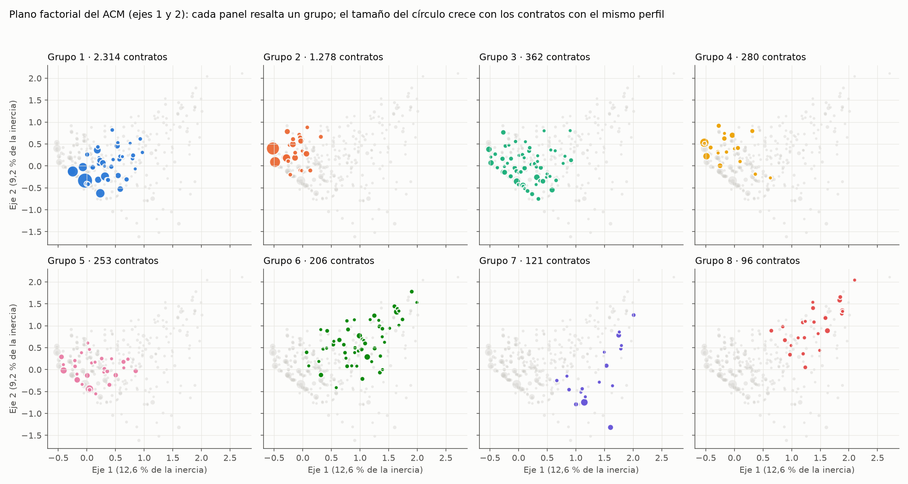

# Descripción de los grupos estables de HCPC (D99)

> **Descripción exploratoria. Ningún modelo de clases latentes cumplió los supuestos (D97, D98), así que estos grupos describen el mercado y no son una tipología confirmada.**

Estado: propuesta, pendiente de revisión de Edward. No se recalculó ningún resultado de D97 a D99; este documento solo describe lo que ya existe.

## Cómo leerlo

- **Grupos:** los 11 de HCPC de D98 (4.992 contratos de SECOP I y II, 2020 a 2025). Se describen los 8 que cumplen el criterio de D99: Jaccard medio de bootstrap ≥ 0,75 y al menos 1 % de los contratos. Quedan fuera los grupos 6 (47 contratos), 8 (34) y 11 (1), todos por debajo del 1 %.
- **Nombres:** «Grupo 1» a «Grupo 8» en orden de tamaño (nombres neutros). La tabla resumen da la equivalencia con el número de grupo de HCPC de D98.
- **Categorías características:** prueba v de `FactoMineR` (`hcpc_d98_vtest.csv`), solo las de |v| > 2, ordenadas de mayor a menor v (las primeras están sobrerrepresentadas en el grupo y las últimas subrepresentadas). «∞» indica que la prueba es numéricamente infinita (p < 10⁻³⁰⁰): la categoría define al grupo. Las variables son las del ACM de D98: tipo de entidad, modalidad, tipo de contrato, orden, y los seis componentes (inhumación o cremación, traslado, ataúdes o bienes, plan exequial, operación de cementerio, atención a población vulnerable o NN).
- **Porcentajes de la tabla de cada grupo:** «% del grupo» es el porcentaje de los contratos del grupo que tienen la categoría; «% del total» es el mismo porcentaje en los 4.992 contratos; «% de la categoría en el grupo» es qué parte de los contratos con esa categoría cae en el grupo.
- **Valores:** pesos constantes de 2025 (IPC DANE). El porcentaje del valor es sobre el total de los 4.992 contratos.
- **Plano factorial:** coordenadas del mismo ACM (variables y semilla de D98); solo se recuperaron las coordenadas de los contratos, sin correr el HCPC, y los porcentajes de inercia coinciden con `hcpc_d98_inercia.csv`.
- **Ejemplos:** tres objetos por grupo elegidos al azar (semilla 2026), sin filtrar por tema, recortados a 180 caracteres y anonimizados (D15).

## Tabla resumen

| Grupo | Grupo HCPC (D98) | Contratos | % contratos | Valor total | Mediana | % del valor | Jaccard medio | Rasgos principales |
|---|---|---|---|---|---|---|---|---|
| Grupo 1 | 5 | 2.314 | 46,4 % | $65.853 millones | $21,0 millones | 28,6 % | 0,96 | alcaldías municipales; prestación de servicios; sin ataúdes ni bienes |
| Grupo 2 | 1 | 1.278 | 25,6 % | $28.768 millones | $20,5 millones | 12,5 % | 0,96 | alcaldías municipales; suministro; con ataúdes o bienes |
| Grupo 3 | 4 | 362 | 7,3 % | $15.322 millones | $28,1 millones | 6,6 % | 0,91 | con traslado; gobernaciones o departamentos; contratación directa |
| Grupo 4 | 2 | 280 | 5,6 % | $5.658 millones | $17,0 millones | 2,5 % | 0,87 | compraventa; con ataúdes o bienes; sin inhumación ni cremación |
| Grupo 5 | 3 | 253 | 5,1 % | $61.612 millones | $113,9 millones | 26,7 % | 0,87 | selección abreviada; con inhumación o cremación; otras entidades |
| Grupo 6 | 7 | 206 | 4,1 % | $9.753 millones | $12,4 millones | 4,2 % | 0,77 | otras entidades; orden nacional; con plan exequial |
| Grupo 7 | 9 | 121 | 2,4 % | $5.587 millones | $32,4 millones | 2,4 % | 0,91 | empresas de servicios públicos; sin atención a población vulnerable o NN; contratación directa |
| Grupo 8 | 10 | 96 | 1,9 % | $6.270 millones | $19,8 millones | 2,7 % | 0,93 | entidades de salud u hospitales; régimen especial; sin atención a población vulnerable o NN |

Los 8 grupos suman 4.910 de 4.992 contratos (98,4 %).

## Plano factorial del ACM

Cada panel resalta un grupo en su color y deja los demás contratos en gris. Muchos contratos comparten exactamente el mismo perfil de categorías, por lo que se dibujan como un solo círculo cuyo tamaño crece con el número de contratos. Los dos ejes retienen juntos el 21,8 % de la inercia: el plano es un resumen parcial, y grupos que se ven cercanos pueden separarse en otros ejes.

## Grupo 1 (grupo 5 de HCPC)

**Descripción.** Categorías sobrerrepresentadas (porcentaje del grupo frente al del total): alcaldías municipales (99 % frente a 89 %), prestación de servicios (83 % frente a 55 %), sin ataúdes ni bienes (95 % frente a 66 %), con inhumación o cremación (85 % frente a 62 %), mínima cuantía (87 % frente a 81 %).

- **Tamaño:** 2.314 contratos (46,4 % del total).
- **Valor:** suma $65.853 millones; mediana $21,0 millones (28,6 % del valor total).
- **Estabilidad:** Jaccard medio 0,96; percentil 5 0,87; el grupo se disuelve en 0,0 % de los remuestreos.
- **Fuente:** SECOP I 73,3 %, SECOP II 26,7 %.
- **Año:** 2020 20,6 %, 2021 17,7 %, 2022 15,6 %, 2023 17,0 %, 2024 14,4 %, 2025 14,7 %.
- **Departamentos con más contratos (ubicación de la entidad):** Antioquia (257, 11,1 %), Boyacá (250, 10,8 %), Valle del Cauca (167, 7,2 %).

| Categoría característica | % del grupo | % del total | % de la categoría en el grupo | v |
|---|---|---|---|---|
| `ataudes_bienes: no` | 95,2 | 66,5 | 66,4 | ∞ |
| `tipo_contrato_hom: prestacion_servicios` | 83,4 | 55,0 | 70,4 | ∞ |
| `inhumacion_cremacion: sí` | 85,4 | 62,4 | 63,5 | 32,2 |
| `tipo_entidad: alcaldia_municipio` | 99,3 | 88,7 | 51,9 | 24,7 |
| `traslado: no` | 100,0 | 93,9 | 49,4 | 19,8 |
| `atencion_vulnerables_NN: sí` | 88,0 | 81,0 | 50,4 | 11,9 |
| `modalidad_grupo: minima_cuantia` | 87,3 | 80,5 | 50,2 | 11,4 |
| `orden_nivel: TERRITORIAL` | 100,0 | 97,9 | 47,3 | 11,2 |
| `operacion_cementerio: no` | 100,0 | 98,8 | 46,9 | 8,5 |
| `plan_exequial: no` | 94,9 | 91,7 | 48,0 | 7,7 |
| `modalidad_grupo: contratacion_directa` | 12,4 | 10,5 | 54,9 | 4,1 |
| `modalidad_grupo: otras` | 0,0 | 0,2 | 0,0 | -3,4 |
| `tipo_contrato_hom: sin_equivalente` | 1,8 | 2,7 | 29,9 | -4,0 |
| `tipo_entidad: otras` | 0,0 | 0,5 | 0,0 | -5,4 |
| `tipo_contrato_hom: otras` | 0,0 | 0,9 | 0,0 | -7,0 |
| `plan_exequial: sí` | 5,1 | 8,3 | 28,5 | -7,7 |
| `operacion_cementerio: sí` | 0,0 | 1,2 | 0,0 | -8,5 |
| `tipo_entidad: salud_hospital_ese` | 0,0 | 1,7 | 0,0 | -10,1 |
| `orden_nivel: NACIONAL` | 0,0 | 2,1 | 0,0 | -11,2 |
| `tipo_entidad: gobernacion_departamento` | 0,0 | 2,1 | 0,0 | -11,2 |
| `atencion_vulnerables_NN: no` | 12,0 | 19,0 | 29,2 | -11,9 |
| `tipo_entidad: servicios_publicos_empresa` | 0,0 | 2,4 | 0,0 | -12,1 |
| `modalidad_grupo: regimen_especial` | 0,3 | 3,2 | 4,3 | -12,2 |
| `tipo_entidad: otra_entidad` | 0,7 | 4,6 | 7,0 | -13,3 |
| `modalidad_grupo: seleccion_abreviada` | 0,0 | 5,5 | 0,0 | -18,7 |
| `tipo_contrato_hom: compraventa` | 0,0 | 5,9 | 0,0 | -19,3 |
| `traslado: sí` | 0,0 | 6,1 | 0,0 | -19,8 |
| `tipo_contrato_hom: suministro` | 14,8 | 35,6 | 19,3 | -29,3 |
| `inhumacion_cremacion: no` | 14,6 | 37,6 | 18,0 | -32,2 |
| `ataudes_bienes: sí` | 4,8 | 33,5 | 6,7 | −∞ |

Objetos de ejemplo (azar, semilla 2026):

1. PRESTACION DE SERVICIOS FUNERARIOS A LA POBLACION VULNERABLE DEL MUNICIPIO DE GALAPA
2. PRESTACION DE SERVICIOS EXEQUIALES A LA POBLACIÓN VULNERABLE Y VICTIMAS DE COVID-19 EN SITUACIÓN DE VULNERABILIDAD DEL MUNICIPIO DE QUIMBAYA QUINDIO
3. PRESTACIÓN DE SERVICIOS EXEQUIALES PARA LA POBLACIÓN VULNERABLE; POBRES DE SOLEMNIDAD; DE ESCASOS RECURSOS ECONÓMICOS; CUERPOS PNI (PERSONAS NO IDENTIFICADAS) Y PINR (PERSONAS IDEN…

## Grupo 2 (grupo 1 de HCPC)

**Descripción.** Categorías sobrerrepresentadas (porcentaje del grupo frente al del total): alcaldías municipales (100 % frente a 89 %), suministro (93 % frente a 36 %), con ataúdes o bienes (89 % frente a 34 %), mínima cuantía (99 % frente a 81 %), sin inhumación ni cremación (73 % frente a 38 %).

- **Tamaño:** 1.278 contratos (25,6 % del total).
- **Valor:** suma $28.768 millones; mediana $20,5 millones (12,5 % del valor total).
- **Estabilidad:** Jaccard medio 0,96; percentil 5 0,81; el grupo se disuelve en 0,0 % de los remuestreos.
- **Fuente:** SECOP I 90,3 %, SECOP II 9,7 %.
- **Año:** 2020 23,5 %, 2021 21,8 %, 2022 16,4 %, 2023 13,4 %, 2024 13,9 %, 2025 11,0 %.
- **Departamentos con más contratos (ubicación de la entidad):** Nariño (247, 19,3 %), Cauca (114, 8,9 %), Magdalena (87, 6,8 %).

| Categoría característica | % del grupo | % del total | % de la categoría en el grupo | v |
|---|---|---|---|---|
| `ataudes_bienes: sí` | 89,0 | 33,5 | 67,9 | ∞ |
| `tipo_contrato_hom: suministro` | 93,2 | 35,6 | 67,1 | ∞ |
| `inhumacion_cremacion: no` | 73,1 | 37,6 | 49,7 | 30,2 |
| `modalidad_grupo: minima_cuantia` | 98,7 | 80,5 | 31,4 | 22,5 |
| `tipo_entidad: alcaldia_municipio` | 99,8 | 88,7 | 28,8 | 17,9 |
| `traslado: no` | 100,0 | 93,9 | 27,3 | 13,5 |
| `atencion_vulnerables_NN: sí` | 91,8 | 81,0 | 29,0 | 12,2 |
| `plan_exequial: no` | 95,8 | 91,7 | 26,7 | 6,5 |
| `operacion_cementerio: no` | 100,0 | 98,8 | 25,9 | 5,7 |
| `orden_nivel: TERRITORIAL` | 99,2 | 97,9 | 25,9 | 4,1 |
| `modalidad_grupo: otras` | 0,0 | 0,2 | 0,0 | -2,2 |
| `tipo_entidad: otras` | 0,0 | 0,5 | 0,0 | -3,5 |
| `orden_nivel: NACIONAL` | 0,8 | 2,1 | 9,7 | -4,0 |
| `tipo_contrato_hom: otras` | 0,0 | 0,9 | 0,0 | -4,7 |
| `operacion_cementerio: sí` | 0,0 | 1,2 | 0,0 | -5,7 |
| `tipo_contrato_hom: sin_equivalente` | 0,5 | 2,7 | 5,1 | -6,4 |
| `plan_exequial: sí` | 4,2 | 8,3 | 13,0 | -6,5 |
| `tipo_entidad: salud_hospital_ese` | 0,0 | 1,7 | 0,0 | -6,8 |
| `tipo_entidad: gobernacion_departamento` | 0,0 | 2,1 | 0,0 | -7,6 |
| `tipo_entidad: servicios_publicos_empresa` | 0,0 | 2,4 | 0,0 | -8,2 |
| `modalidad_grupo: regimen_especial` | 0,0 | 3,2 | 0,0 | -9,6 |
| `tipo_entidad: otra_entidad` | 0,2 | 4,6 | 1,3 | -10,5 |
| `atencion_vulnerables_NN: no` | 8,2 | 19,0 | 11,1 | -12,2 |
| `modalidad_grupo: seleccion_abreviada` | 0,0 | 5,5 | 0,0 | -12,7 |
| `tipo_contrato_hom: compraventa` | 0,0 | 5,9 | 0,0 | -13,2 |
| `traslado: sí` | 0,0 | 6,1 | 0,0 | -13,5 |
| `modalidad_grupo: contratacion_directa` | 1,3 | 10,5 | 3,3 | -14,5 |
| `inhumacion_cremacion: sí` | 26,9 | 62,4 | 11,1 | -30,2 |
| `ataudes_bienes: no` | 11,0 | 66,5 | 4,2 | −∞ |
| `tipo_contrato_hom: prestacion_servicios` | 6,3 | 55,0 | 2,9 | −∞ |

Objetos de ejemplo (azar, semilla 2026):

1. SUMINISTRO DE COFRES FÚNEBRES PARA POBLACIÓN EN SITUACIÓN DE VULNERACIÓN; CADÁVERES EN CONDICIÓN DE NO IDENTIFICACIÓN Y PERSONAS QUE SE ENCUENTREN REGISTRADAS COMO VICTIMAS DEL CON…
2. SUMINISTRO DE COFRES FUNEBRES (ATAÙDES) PARA PERSONAS DE BAJOS RECURSOS U OCCISOS NO IDENTIFICADOS EN EL MUNICIPIO DE EBÉJICO
3. SERVICIOS FUNERARIOS Y SUMINISTRO DE COFRES FUNEBRES PARA LA POBLACION EN SITUACIÓN DE VULNERABILIDAD; CADÁVERES EN CONDICIÓN DE NO IDENTIFICACIÓN Y PERSONAS QUE SE ENCUENTREN REGI…

## Grupo 3 (grupo 4 de HCPC)

**Descripción.** Categorías sobrerrepresentadas (porcentaje del grupo frente al del total): con traslado (80 % frente a 6 %), gobernaciones o departamentos (26 % frente a 2 %), contratación directa (17 % frente a 10 %), sin atención a población vulnerable o NN (30 % frente a 19 %).

- **Tamaño:** 362 contratos (7,3 % del total).
- **Valor:** suma $15.322 millones; mediana $28,1 millones (6,6 % del valor total).
- **Estabilidad:** Jaccard medio 0,91; percentil 5 0,70; el grupo se disuelve en 0,0 % de los remuestreos.
- **Fuente:** SECOP I 65,5 %, SECOP II 34,5 %.
- **Año:** 2020 27,6 %, 2021 20,4 %, 2022 15,5 %, 2023 12,7 %, 2024 11,0 %, 2025 12,7 %.
- **Departamentos con más contratos (ubicación de la entidad):** Antioquia (41, 11,3 %), Norte De Santander (27, 7,5 %), Córdoba (25, 6,9 %).

| Categoría característica | % del grupo | % del total | % de la categoría en el grupo | v |
|---|---|---|---|---|
| `traslado: sí` | 79,6 | 6,1 | 94,1 | ∞ |
| `tipo_entidad: gobernacion_departamento` | 26,0 | 2,1 | 90,4 | 21,2 |
| `atencion_vulnerables_NN: no` | 29,6 | 19,0 | 11,3 | 5,0 |
| `modalidad_grupo: contratacion_directa` | 16,6 | 10,5 | 11,5 | 3,7 |
| `orden_nivel: TERRITORIAL` | 100,0 | 97,9 | 7,4 | 3,6 |
| `inhumacion_cremacion: sí` | 69,9 | 62,4 | 8,1 | 3,1 |
| `tipo_contrato_hom: prestacion_servicios` | 61,9 | 55,0 | 8,2 | 2,8 |
| `operacion_cementerio: no` | 100,0 | 98,8 | 7,3 | 2,6 |
| `tipo_contrato_hom: otras` | 0,0 | 0,9 | 0,0 | -2,1 |
| `operacion_cementerio: sí` | 0,0 | 1,2 | 0,0 | -2,6 |
| `inhumacion_cremacion: no` | 30,1 | 37,6 | 5,8 | -3,1 |
| `tipo_entidad: salud_hospital_ese` | 0,0 | 1,7 | 0,0 | -3,2 |
| `orden_nivel: NACIONAL` | 0,0 | 2,1 | 0,0 | -3,5 |
| `modalidad_grupo: seleccion_abreviada` | 1,7 | 5,5 | 2,2 | -3,8 |
| `tipo_entidad: servicios_publicos_empresa` | 0,0 | 2,4 | 0,0 | -3,9 |
| `modalidad_grupo: regimen_especial` | 0,0 | 3,2 | 0,0 | -4,6 |
| `tipo_entidad: otra_entidad` | 0,3 | 4,6 | 0,4 | -5,0 |
| `atencion_vulnerables_NN: sí` | 70,4 | 81,0 | 6,3 | -5,0 |
| `tipo_contrato_hom: compraventa` | 0,8 | 5,9 | 1,0 | -5,1 |
| `tipo_entidad: alcaldia_municipio` | 73,8 | 88,7 | 6,0 | -8,3 |
| `traslado: no` | 20,4 | 93,9 | 1,6 | −∞ |

Objetos de ejemplo (azar, semilla 2026):

1. SUMINISTRO DE SERVICIOS FUNEBRES PARA EL MANEJO; TRASLADO Y DISPOSICION FINAL DE CADAVERES POR COVID - 19 EN EL MUNICIPIO DE MON~ITOS
2. PRESTACIÓN DE SERVICIO FUNERARIO PARA TRASLADO Y DISPOSICIÓN FINAL DE PERSONAS FALLECIDAS POR COVID-19 EN EL MUNICIPIO DE QUIPAMA BOYACA VIGENCIA 2020
3. PRESTAR SERVICIOS DE ASISTENCIA FUNERARIA Y EXEQUIALES PARA LOS ADULTOS MAYORES EN SITAUCIÓN DE VULNERABILIDAD EN EL MARCO DEL PROYECTO. FORTALECIMIENTO DE ATENCIÓN EN LOS SERVICIO…

## Grupo 4 (grupo 2 de HCPC)

**Descripción.** Categorías sobrerrepresentadas (porcentaje del grupo frente al del total): compraventa (100 % frente a 6 %), con ataúdes o bienes (79 % frente a 34 %), sin inhumación ni cremación (75 % frente a 38 %), mínima cuantía (99 % frente a 81 %), alcaldías municipales (98 % frente a 89 %).

- **Tamaño:** 280 contratos (5,6 % del total).
- **Valor:** suma $5.658 millones; mediana $17,0 millones (2,5 % del valor total).
- **Estabilidad:** Jaccard medio 0,87; percentil 5 0,15; el grupo se disuelve en 8,0 % de los remuestreos.
- **Fuente:** SECOP I 93,6 %, SECOP II 6,4 %.
- **Año:** 2020 22,1 %, 2021 16,8 %, 2022 17,1 %, 2023 17,5 %, 2024 12,9 %, 2025 13,6 %.
- **Departamentos con más contratos (ubicación de la entidad):** Nariño (52, 18,6 %), Cauca (51, 18,2 %), Norte De Santander (25, 8,9 %).

| Categoría característica | % del grupo | % del total | % de la categoría en el grupo | v |
|---|---|---|---|---|
| `tipo_contrato_hom: compraventa` | 100,0 | 5,9 | 95,6 | ∞ |
| `ataudes_bienes: sí` | 79,3 | 33,5 | 13,3 | 16,2 |
| `inhumacion_cremacion: no` | 74,6 | 37,6 | 11,1 | 12,9 |
| `modalidad_grupo: minima_cuantia` | 99,3 | 80,5 | 6,9 | 10,2 |
| `tipo_entidad: alcaldia_municipio` | 97,9 | 88,7 | 6,2 | 5,8 |
| `traslado: no` | 98,9 | 93,9 | 5,9 | 4,3 |
| `atencion_vulnerables_NN: sí` | 90,0 | 81,0 | 6,2 | 4,2 |
| `plan_exequial: sí` | 12,5 | 8,3 | 8,5 | 2,5 |
| `orden_nivel: TERRITORIAL` | 99,6 | 97,9 | 5,7 | 2,3 |
| `orden_nivel: NACIONAL` | 0,4 | 2,1 | 1,0 | -2,3 |
| `plan_exequial: no` | 87,5 | 91,7 | 5,4 | -2,5 |
| `tipo_entidad: salud_hospital_ese` | 0,0 | 1,7 | 0,0 | -2,7 |
| `tipo_entidad: servicios_publicos_empresa` | 0,0 | 2,4 | 0,0 | -3,3 |
| `tipo_contrato_hom: sin_equivalente` | 0,0 | 2,7 | 0,0 | -3,6 |
| `modalidad_grupo: regimen_especial` | 0,0 | 3,2 | 0,0 | -4,0 |
| `atencion_vulnerables_NN: no` | 10,0 | 19,0 | 3,0 | -4,2 |
| `traslado: sí` | 1,1 | 6,1 | 1,0 | -4,3 |
| `tipo_entidad: otra_entidad` | 0,0 | 4,6 | 0,0 | -4,8 |
| `modalidad_grupo: seleccion_abreviada` | 0,0 | 5,5 | 0,0 | -5,4 |
| `modalidad_grupo: contratacion_directa` | 0,7 | 10,5 | 0,4 | -6,8 |
| `inhumacion_cremacion: sí` | 25,4 | 62,4 | 2,3 | -12,9 |
| `tipo_contrato_hom: suministro` | 0,0 | 35,6 | 0,0 | -15,8 |
| `ataudes_bienes: no` | 20,7 | 66,5 | 1,7 | -16,2 |
| `tipo_contrato_hom: prestacion_servicios` | 0,0 | 55,0 | 0,0 | -21,5 |

Objetos de ejemplo (azar, semilla 2026):

1. COMPRAVENTA DE CAJAS MORTUORIAS PARA LA INHUMACIÓN DE CADÁVERES DE PERSONAS POBRES DE SOLEMNIDAD DEL MUNICIPIO SANTA ROSA; CAUCA.
2. SUMINISTRO DE COFRES MORTUORIOS DESTINADO A LA POBLACIÓN VÍCTIMA DE LA VIOLENCIA DEL MUNICIPIO DE LA TOLA (N)
3. COMPRAVENTA DE POLIZA PLAN EXEQUIAL PARA LOS ADULTOS MAYORES DEL CENTRO VIDA DEL MUNICIPIO DE ARBOLEDAS; NORTE DE SANTANDER

## Grupo 5 (grupo 3 de HCPC)

**Descripción.** Categorías sobrerrepresentadas (porcentaje del grupo frente al del total): selección abreviada (100 % frente a 6 %), con inhumación o cremación (83 % frente a 62 %), otras entidades (10 % frente a 5 %).

- **Tamaño:** 253 contratos (5,1 % del total).
- **Valor:** suma $61.612 millones; mediana $113,9 millones (26,7 % del valor total).
- **Estabilidad:** Jaccard medio 0,87; percentil 5 0,07; el grupo se disuelve en 9,5 % de los remuestreos.
- **Fuente:** SECOP II 50,2 %, SECOP I 49,8 %.
- **Año:** 2020 9,9 %, 2021 19,4 %, 2022 21,7 %, 2023 19,4 %, 2024 15,0 %, 2025 14,6 %.
- **Departamentos con más contratos (ubicación de la entidad):** Córdoba (38, 15,0 %), Cesar (24, 9,5 %), Santander (23, 9,1 %).

| Categoría característica | % del grupo | % del total | % de la categoría en el grupo | v |
|---|---|---|---|---|
| `modalidad_grupo: seleccion_abreviada` | 100,0 | 5,5 | 92,0 | ∞ |
| `inhumacion_cremacion: sí` | 82,6 | 62,4 | 6,7 | 7,2 |
| `tipo_entidad: otra_entidad` | 10,3 | 4,6 | 11,4 | 3,9 |
| `traslado: no` | 98,4 | 93,9 | 5,3 | 3,5 |
| `atencion_vulnerables_NN: sí` | 88,1 | 81,0 | 5,5 | 3,1 |
| `orden_nivel: TERRITORIAL` | 100,0 | 97,9 | 5,2 | 2,9 |
| `plan_exequial: no` | 96,0 | 91,7 | 5,3 | 2,8 |
| `ataudes_bienes: no` | 73,5 | 66,5 | 5,6 | 2,5 |
| `operacion_cementerio: no` | 100,0 | 98,8 | 5,1 | 2,0 |
| `operacion_cementerio: sí` | 0,0 | 1,2 | 0,0 | -2,0 |
| `ataudes_bienes: sí` | 26,5 | 33,5 | 4,0 | -2,5 |
| `tipo_entidad: salud_hospital_ese` | 0,0 | 1,7 | 0,0 | -2,5 |
| `plan_exequial: sí` | 4,0 | 8,3 | 2,4 | -2,8 |
| `orden_nivel: NACIONAL` | 0,0 | 2,1 | 0,0 | -2,8 |
| `atencion_vulnerables_NN: no` | 11,9 | 19,0 | 3,2 | -3,1 |
| `tipo_entidad: servicios_publicos_empresa` | 0,0 | 2,4 | 0,0 | -3,1 |
| `tipo_contrato_hom: compraventa` | 1,6 | 5,9 | 1,4 | -3,4 |
| `traslado: sí` | 1,6 | 6,1 | 1,3 | -3,5 |
| `modalidad_grupo: regimen_especial` | 0,0 | 3,2 | 0,0 | -3,7 |
| `inhumacion_cremacion: no` | 17,4 | 37,6 | 2,3 | -7,2 |
| `modalidad_grupo: contratacion_directa` | 0,0 | 10,5 | 0,0 | -7,3 |
| `modalidad_grupo: minima_cuantia` | 0,0 | 80,5 | 0,0 | -29,7 |

Objetos de ejemplo (azar, semilla 2026):

1. SUMINISTRO DE KITS ESCOLARES PARA POBLACION ESTUDIANTIL DEL MUNICIPIO DE EL ROSARIO 2020
2. PRESTACION DE SERVICIOS FUNERARIOS INTEGRALES A POBLACION VICTIMA DEL CONFLICTO ARMADO EN EL MUNICIPIO DE SARAVENA DEPARTAMENTO DE ARAUCA
3. SERVICIOS FUNERARIOS; A PERSONAS FALLECIDAS; SISBENIZADAS EN LOS NIVELES 0; 1 Y 2; MUERTO NN O VÍCTIMAS DEL CONFLICTO ARMADO QUE AL MOMENTO DE SU DECESO SUS FAMILIARES NO CUENTEN C…

## Grupo 6 (grupo 7 de HCPC)

**Descripción.** Categorías sobrerrepresentadas (porcentaje del grupo frente al del total): otras entidades (85 % frente a 5 %), orden nacional (41 % frente a 2 %), con plan exequial (60 % frente a 8 %), sin atención a población vulnerable o NN (78 % frente a 19 %), régimen especial (21 % frente a 3 %).

- **Tamaño:** 206 contratos (4,1 % del total).
- **Valor:** suma $9.753 millones; mediana $12,4 millones (4,2 % del valor total).
- **Estabilidad:** Jaccard medio 0,77; percentil 5 0,35; el grupo se disuelve en 26,0 % de los remuestreos.
- **Fuente:** SECOP II 69,9 %, SECOP I 30,1 %.
- **Año:** 2020 18,0 %, 2021 21,8 %, 2022 16,0 %, 2023 13,6 %, 2024 15,0 %, 2025 15,5 %.
- **Departamentos con más contratos (ubicación de la entidad):** Valle del Cauca (41, 19,9 %), Distrito Capital de Bogotá (31, 15,0 %), Antioquia (25, 12,1 %).

| Categoría característica | % del grupo | % del total | % de la categoría en el grupo | v |
|---|---|---|---|---|
| `tipo_entidad: otra_entidad` | 85,0 | 4,6 | 76,8 | 33,0 |
| `orden_nivel: NACIONAL` | 40,8 | 2,1 | 81,6 | 21,8 |
| `plan_exequial: sí` | 60,2 | 8,3 | 30,0 | 19,7 |
| `atencion_vulnerables_NN: no` | 78,2 | 19,0 | 17,0 | 18,9 |
| `ataudes_bienes: no` | 98,1 | 66,5 | 6,1 | 11,7 |
| `modalidad_grupo: regimen_especial` | 21,4 | 3,2 | 27,2 | 10,4 |
| `inhumacion_cremacion: no` | 66,5 | 37,6 | 7,3 | 8,5 |
| `tipo_contrato_hom: sin_equivalente` | 14,1 | 2,7 | 21,2 | 7,4 |
| `tipo_contrato_hom: prestacion_servicios` | 76,7 | 55,0 | 5,8 | 6,6 |
| `traslado: no` | 100,0 | 93,9 | 4,4 | 4,8 |
| `tipo_entidad: salud_hospital_ese` | 0,0 | 1,7 | 0,0 | -2,2 |
| `tipo_entidad: gobernacion_departamento` | 0,0 | 2,1 | 0,0 | -2,5 |
| `tipo_entidad: servicios_publicos_empresa` | 0,0 | 2,4 | 0,0 | -2,7 |
| `tipo_contrato_hom: compraventa` | 1,5 | 5,9 | 1,0 | -3,1 |
| `traslado: sí` | 0,0 | 6,1 | 0,0 | -4,8 |
| `modalidad_grupo: minima_cuantia` | 65,0 | 80,5 | 3,3 | -5,3 |
| `inhumacion_cremacion: sí` | 33,5 | 62,4 | 2,2 | -8,5 |
| `tipo_contrato_hom: suministro` | 7,8 | 35,6 | 0,9 | -9,5 |
| `ataudes_bienes: sí` | 1,9 | 33,5 | 0,2 | -11,7 |
| `atencion_vulnerables_NN: sí` | 21,8 | 81,0 | 1,1 | -18,9 |
| `plan_exequial: no` | 39,8 | 91,7 | 1,8 | -19,7 |
| `orden_nivel: TERRITORIAL` | 59,2 | 97,9 | 2,5 | -21,7 |
| `tipo_entidad: alcaldia_municipio` | 15,0 | 88,7 | 0,7 | -25,5 |

Objetos de ejemplo (azar, semilla 2026):

1. CONTRATAR LA PRESTACIÓN DE SERVICIOS FUNERARIOS Y/O PLAN EXEQUIAL PARA LOS TREINTA Y OCHO (38) FUNCIONARIOS DE PLANTA DEL INCIVA; Y SU GRUPO FAMILIAR; CON O SIN PARENTESCO.
2. CONTRATAR UN PLAN EXEQUIAL QUE AMPARE A LOS SERVIDORES PÚBLICOS SINDICALIZADOS QUE LABORAN AL SERVICIO DE LA LOTERÍA SANTANDER
3. PRESTACIÓN INTEGRAL DE SERVICIOS FUNERARIOS A NIVEL NACIONAL PARA EL PERSONAL MILITAR; ALUMNOS DE LAS ESCUELAS DE FORMACIÓN Y EMPLEADOS PÚBLICOS DEL MINISTERIO DE DEFENSA NACIONAL…

## Grupo 7 (grupo 9 de HCPC)

**Descripción.** Categorías sobrerrepresentadas (porcentaje del grupo frente al del total): empresas de servicios públicos (95 % frente a 2 %), sin atención a población vulnerable o NN (100 % frente a 19 %), contratación directa (69 % frente a 10 %), con operación de cementerio (21 % frente a 1 %), régimen especial (24 % frente a 3 %).

- **Tamaño:** 121 contratos (2,4 % del total).
- **Valor:** suma $5.587 millones; mediana $32,4 millones (2,4 % del valor total).
- **Estabilidad:** Jaccard medio 0,91; percentil 5 0,79; el grupo se disuelve en 0,5 % de los remuestreos.
- **Fuente:** SECOP II 81,0 %, SECOP I 19,0 %.
- **Año:** 2020 14,0 %, 2021 15,7 %, 2022 17,4 %, 2023 10,7 %, 2024 13,2 %, 2025 28,9 %.
- **Departamentos con más contratos (ubicación de la entidad):** Distrito Capital de Bogotá (86, 71,1 %), Cesar (5, 4,1 %), Bolívar (5, 4,1 %).

| Categoría característica | % del grupo | % del total | % de la categoría en el grupo | v |
|---|---|---|---|---|
| `tipo_entidad: servicios_publicos_empresa` | 95,0 | 2,4 | 96,6 | 31,7 |
| `atencion_vulnerables_NN: no` | 100,0 | 19,0 | 12,8 | 20,2 |
| `modalidad_grupo: contratacion_directa` | 68,6 | 10,5 | 15,9 | 15,6 |
| `operacion_cementerio: sí` | 21,5 | 1,2 | 42,6 | 10,8 |
| `ataudes_bienes: no` | 100,0 | 66,5 | 3,6 | 9,8 |
| `modalidad_grupo: regimen_especial` | 24,0 | 3,2 | 17,9 | 8,7 |
| `tipo_contrato_hom: prestacion_servicios` | 90,1 | 55,0 | 4,0 | 8,5 |
| `traslado: no` | 100,0 | 93,9 | 2,6 | 3,5 |
| `inhumacion_cremacion: sí` | 74,4 | 62,4 | 2,9 | 2,8 |
| `plan_exequial: sí` | 15,7 | 8,3 | 4,6 | 2,7 |
| `tipo_contrato_hom: sin_equivalente` | 6,6 | 2,7 | 5,8 | 2,3 |
| `modalidad_grupo: seleccion_abreviada` | 1,7 | 5,5 | 0,7 | -2,0 |
| `plan_exequial: no` | 84,3 | 91,7 | 2,2 | -2,7 |
| `inhumacion_cremacion: no` | 25,6 | 37,6 | 1,6 | -2,8 |
| `tipo_entidad: otra_entidad` | 0,0 | 4,6 | 0,0 | -2,9 |
| `tipo_contrato_hom: compraventa` | 0,0 | 5,9 | 0,0 | -3,4 |
| `traslado: sí` | 0,0 | 6,1 | 0,0 | -3,5 |
| `tipo_contrato_hom: suministro` | 3,3 | 35,6 | 0,2 | -8,7 |
| `ataudes_bienes: sí` | 0,0 | 33,5 | 0,0 | -9,8 |
| `operacion_cementerio: no` | 78,5 | 98,8 | 1,9 | -10,8 |
| `modalidad_grupo: minima_cuantia` | 5,8 | 80,5 | 0,2 | -18,2 |
| `atencion_vulnerables_NN: sí` | 0,0 | 81,0 | 0,0 | -20,2 |
| `tipo_entidad: alcaldia_municipio` | 5,0 | 88,7 | 0,1 | -21,8 |

Objetos de ejemplo (azar, semilla 2026):

1. SERVICIOS DE PREVENCIÓN EXEQUIAL Y SEGURO DE VIDA PARA LOS FUNCIONARIOS Y SU GRUPO FAMILIAR DE LA EAAV-ESP
2. PRESTACION DE SERVICIO PARA LA ADQUISICION DE PLAN EXEQUIAL PARA LOS SERVIDORES PUBLICOS SINDICALIZADOS QUE LABORAN EN LA EMPRESA DE SERVICIOS PUBLICOS DE AGUACHICA E.S.P
3. SSF-058 PRESTAR EL SERVICIO DE RECOLECCIÓN; TRANSPORTE; ALMACENAMIENTO; TRATAMIENTO Y DISPOSICIÓN FINAL DE LOS RESIDUOS PELIGROSOS GENERADOS EN LOS CEMENTERIOS PROPIEDAD DEL DISTRI…

## Grupo 8 (grupo 10 de HCPC)

**Descripción.** Categorías sobrerrepresentadas (porcentaje del grupo frente al del total): entidades de salud u hospitales (85 % frente a 2 %), régimen especial (83 % frente a 3 %), sin atención a población vulnerable o NN (86 % frente a 19 %), tipo de contrato sin equivalente (32 % frente a 3 %).

- **Tamaño:** 96 contratos (1,9 % del total).
- **Valor:** suma $6.270 millones; mediana $19,8 millones (2,7 % del valor total).
- **Estabilidad:** Jaccard medio 0,93; percentil 5 0,76; el grupo se disuelve en 0,0 % de los remuestreos.
- **Fuente:** SECOP I 60,4 %, SECOP II 39,6 %.
- **Año:** 2020 28,1 %, 2021 30,2 %, 2022 15,6 %, 2023 8,3 %, 2024 9,4 %, 2025 8,3 %.
- **Departamentos con más contratos (ubicación de la entidad):** Valle del Cauca (24, 25,0 %), Cesar (9, 9,4 %), Risaralda (8, 8,3 %).

| Categoría característica | % del grupo | % del total | % de la categoría en el grupo | v |
|---|---|---|---|---|
| `tipo_entidad: salud_hospital_ese` | 85,4 | 1,7 | 96,5 | 26,9 |
| `modalidad_grupo: regimen_especial` | 83,3 | 3,2 | 49,4 | 22,5 |
| `atencion_vulnerables_NN: no` | 86,5 | 19,0 | 8,8 | 14,5 |
| `tipo_contrato_hom: sin_equivalente` | 32,3 | 2,7 | 22,6 | 10,6 |
| `ataudes_bienes: no` | 93,8 | 66,5 | 2,7 | 6,4 |
| `plan_exequial: sí` | 18,8 | 8,3 | 4,3 | 3,3 |
| `inhumacion_cremacion: no` | 47,9 | 37,6 | 2,4 | 2,1 |
| `inhumacion_cremacion: sí` | 52,1 | 62,4 | 1,6 | -2,1 |
| `tipo_contrato_hom: compraventa` | 1,0 | 5,9 | 0,3 | -2,3 |
| `tipo_entidad: otra_entidad` | 0,0 | 4,6 | 0,0 | -2,6 |
| `modalidad_grupo: seleccion_abreviada` | 0,0 | 5,5 | 0,0 | -2,9 |
| `plan_exequial: no` | 81,2 | 91,7 | 1,7 | -3,3 |
| `ataudes_bienes: sí` | 6,2 | 33,5 | 0,4 | -6,4 |
| `tipo_contrato_hom: suministro` | 6,2 | 35,6 | 0,3 | -6,8 |
| `atencion_vulnerables_NN: sí` | 13,5 | 81,0 | 0,3 | -14,5 |
| `modalidad_grupo: minima_cuantia` | 6,2 | 80,5 | 0,1 | -16,0 |
| `tipo_entidad: alcaldia_municipio` | 14,6 | 88,7 | 0,3 | -17,0 |

Objetos de ejemplo (azar, semilla 2026):

1. PRESTACIÓN DE SERVICIOS DE PLANES EXEQUIALES PARA VEINTICUATRO (24) EMPLEADOS DE PLANTA DE LA ESE MUNICIPAL MANUEL CASTRO TOVAR
2. CPS 310 DE 2020 QUE TIENE COMO OBJETO CONTRATACIÓN SERVICIOS EXEQUIALES PARA EL NUEVO PERSONAL DE PLANTA DURANTE DIEZ MESES DIECISIETE DÍAS.
3. PRESTACION DE SERVICIOS FUNERARIOS A LOS EMPLEADOS DE PLANTA DE LA ESE HOSPITAL REGIONAL NORTE.
